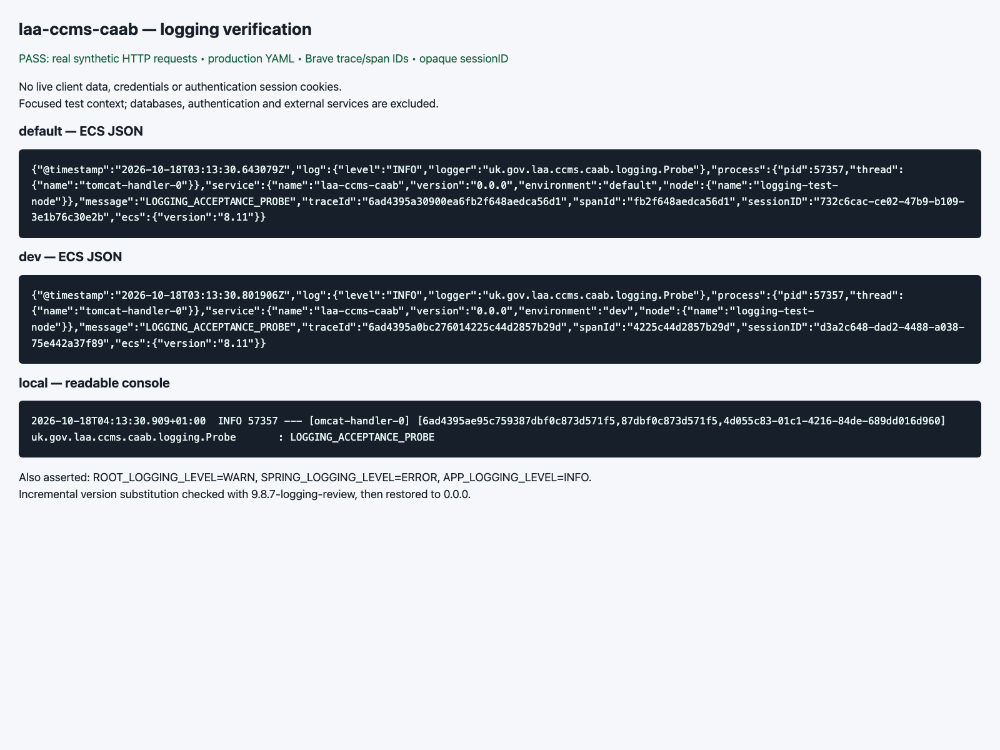

# Logging verification



Captured by `LoggingAcceptanceTest` using the processed production `application.yml`, an
embedded HTTP server, Spring MVC observation and Micrometer Brave auto-configuration.
This focused test context excludes database, authentication and external integrations;
it is not a deployed end-to-end test. All requests and identifiers are synthetic.

Verified with no active profile, `dev`, and `local`:

- ECS JSON metadata and nonempty traceId, spanId and sessionID for request logs.
- Readable local console output with the same correlation fields.
- Root, Spring and application logging environment variables.
- Build version substitution, including a version-only incremental rebuild to
  `9.8.7-logging-review` and restoration of the repository version.
- Asynchronous Mono completions, blocking reactive callbacks and MVC async redispatch retain the request ID.
- Real container ERROR dispatch to `/error` retains the ID and clears MDC in each dispatch scope.
- Concurrent invalidation during session reads/writes falls back to a request-only ID.
- Session correlation reuse, no session creation for stateless calls, and MDC cleanup
  on failures. Raw authentication session IDs are never logged by this filter.

This verifies the tested logging paths; it is not a full audit of every existing log statement.

Raw captures: [default](default.log), [dev](dev.log), [local](local.log).
Screenshot source: [HTML](evidence.html).

Reproduce from the repository root:

```shell
./gradlew test --tests '*logging.*' -x installGitHooks
```

`installGitHooks` is excluded because the existing hook installer assumes `.git` is a
directory, whereas these feature branches are checked out as Git worktrees.
New captures are written under `build/logging-evidence/`.
